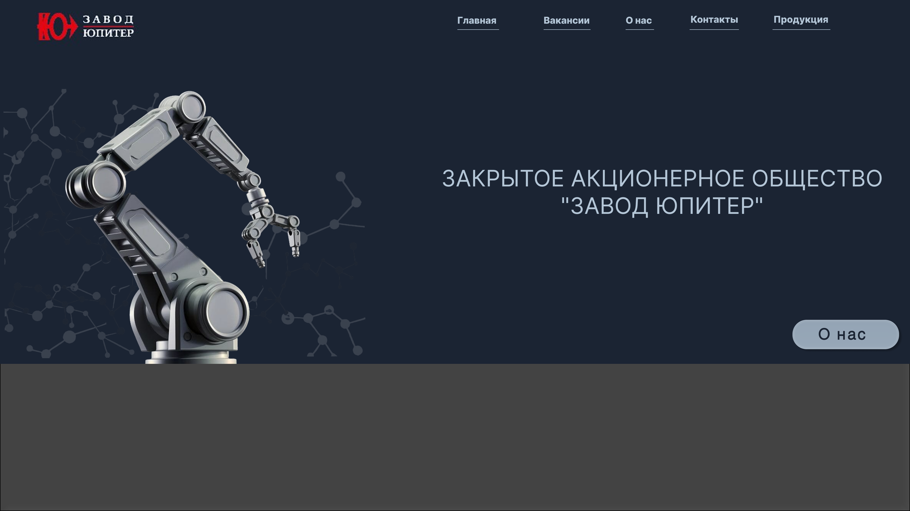

изменила идею сайта и переделала с txt на md
установила  расширения в vs
начала рисовать сайт в Figma 
разбирала  WordPress (читала о нем)
изучала форматы и читала про них в нейросети

##  Макеты из Figma

Ниже представлены скриншот начала дизайна сайта "Завод Юпитер":

## для себя
Логотип завода → SVG (или PNG, если нет вектора).
Фотографии оборудования/цехов → JPG.
Иконки телефонов/почты → SVG.
Скриншоты интерфейса → PNG.